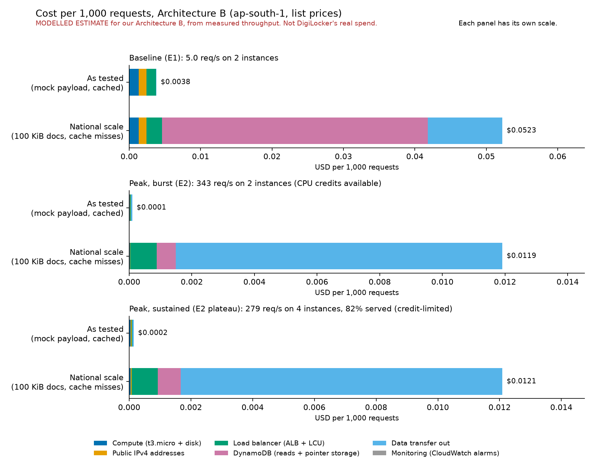
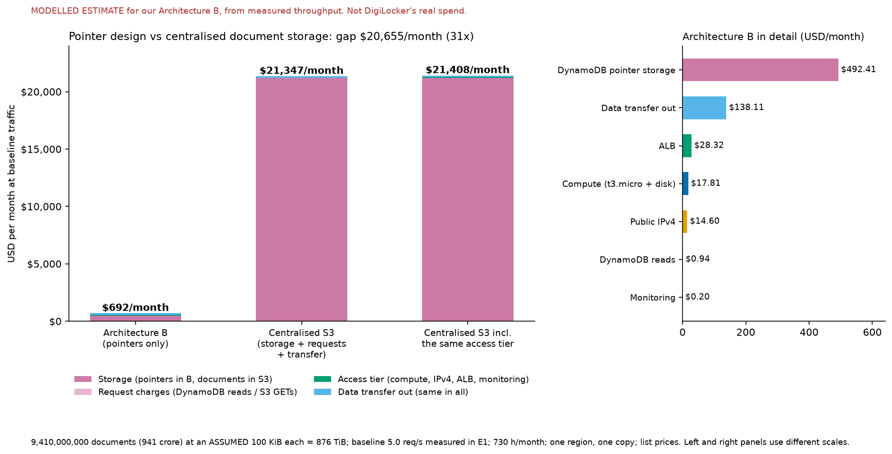

# Cost model: Architecture B and the centralised-storage counterfactual

> **MODELLED ESTIMATE against our Architecture B (the scaled-down build in this
> repository). It is not DigiLocker's real spend.** No infrastructure cost for
> DigiLocker is published (Week 2 report, section 5). Everything below is list price,
> in US dollars, for AWS ap-south-1 (Mumbai), with no free tier, credits or discounts
> applied. The AWS usage during our own runs was covered by account credits, so the
> experiments themselves cost nothing out of pocket; this model prices what the same
> design would cost at list price.

This is the cost work from section 5 of the Week 2 report: cost per 1,000 requests
from measured throughput, in two scenarios (steady baseline and result-day peak), and
the counterfactual that prices centralised document storage so the gap can be read as
the value of the pointer design.

## How to reproduce

```bash
python cost/fetch_rates.py   # reads AWS list prices (read-only) and writes cost/rates.py
python cost/model.py         # reads results/aws/, writes cost/results.json and the two charts
```

`fetch_rates.py` needs AWS credentials that allow `pricing:GetProducts` and creates no
AWS resources. `model.py` needs only matplotlib and the committed files. No figure in
the model is typed in by hand: rates come from `cost/rates.py` (generated), measurements
come from the committed results, and assumptions are labelled constants in section 2 of
`cost/model.py`.

| File | What it is |
|---|---|
| `cost/fetch_rates.py` | Fetches the list prices and writes `rates.py` |
| `cost/rates.py` | Generated rate constants, each with SKU, AWS publication date and retrieval date |
| `cost/rates_raw/` | The raw AWS price record behind each rate, as returned |
| `cost/model.py` | The model: reads results, applies rates and assumptions, writes outputs |
| `cost/results.json` | Every computed number, including all inputs and sensitivities |
| `cost/cost-per-1000-requests.png` | Chart: cost per 1,000 requests, baseline against peak |
| `cost/architecture-b-vs-s3.png` | Chart: Architecture B against the S3 counterfactual |

## 1. Method

### Measured inputs

Taken from the committed results (`results/aws/`). Request counts come from the
load balancer's own CloudWatch metrics; served share, bytes and new connections come
from the raw k6 data for the same minutes. The two request counts agree within 0.7% in
every window (ALB 605 vs k6 601; 41,202 vs 41,208; 50,145 vs 50,116).

| Scenario | Source and window (UTC) | Requests per second | Instances serving | Served | Bytes per request (sent / received) |
|---|---|---|---|---|---|
| Baseline | E1, 19:47 and 19:48 (the two full-rate minutes) | 5.04 | 2 | 100% | 183 / 424 |
| Peak, burst | E2, 21:16 and 21:17 (highest 2-minute throughput) | 343.4 | 2 | 100% | 183 / 424 |
| Peak, sustained | E2, 21:21 to 21:23 (plateau at 200 users) | 278.6 | 4 | 81.6% | 183 / 421 |

"Instances serving" is the minimum number of healthy targets in the window (CloudWatch).
The two peak scenarios are different on purpose:

- **Peak, burst** is the best throughput E2 reached. It was reached by the two original
  instances while they still had CPU credits. It is not sustainable on t3.micro.
- **Peak, sustained** is what the four-instance fleet delivered at the end of E2, when
  the two scale-out instances had run out of CPU credits. Only 81.6% of requests
  returned the real document. See finding A in [research-log.md](research-log.md).

### What the model prices (one hour of the serving fleet)

| Line | Computed as |
|---|---|
| Compute | instances x (t3.micro hourly rate + 8 GB gp3 root disk, per hour) |
| Public IPv4 | (instances + 2 for the load balancer) x hourly rate per in-use address |
| Load balancer | hourly rate + capacity units x LCU rate |
| DynamoDB | pointer lookups x read units x read-unit rate, plus pointer-table storage per hour |
| Data transfer | requests x response bytes, at the first-tier rate per GB out to the internet |
| Monitoring | 2 CloudWatch alarms, at the standard alarm rate, per hour |

Cost per 1,000 requests = cost per hour / (requests per second x 3.6). It is also given
per 1,000 *served* requests for the credit-limited scenario.

Load balancer capacity units are billed on the single highest of four dimensions
(new connections, active connections, processed bytes, rule evaluations), averaged
over the hour. The model computes each from measurement: new connections per second
from the raw k6 data, active connections per minute from CloudWatch, bytes from the
measured bytes per request. Rule evaluations are ignored because the first 10 rules
are free and we use one.

### Two profiles

The load test used a tiny mock payload and four pointers, which is not what a
national-scale service handles. Every scenario is therefore priced twice:

| Profile | Response size | Pointer lookups | Pointer table |
|---|---|---|---|
| **As tested** | measured, about 0.4 KB | cached: at most (instances x 4 pointers x 60 refreshes per hour) | 4 items |
| **National scale** | assumed 100 KiB document | every request is a cache miss and reads DynamoDB | 941 crore pointers |

Compute here is always based on the throughput we measured. For the national-scale
profile that means the compute line is a **lower bound**: real 100 KiB documents would
lower the throughput each instance can sustain, and we did not measure that.

## 2. Rates

All rates retrieved on **2026-10-31 (UTC)** from the AWS Price List API
(`pricing:GetProducts`) for Asia Pacific (Mumbai). Each is a labelled constant in
`cost/rates.py`, with the raw record in `cost/rates_raw/`. These are AWS's published
list prices; the Pricing Calculator web page itself could not be queried (section 6
lists what to confirm there).

| Constant | Value (USD) | Unit | SKU | AWS published |
|---|---|---|---|---|
| `EC2_T3_MICRO_USD_PER_HOUR` | 0.0112 | per hour | 9NX7BP9ZGC9GB8AX | 2026-10-29 |
| `EBS_GP3_USD_PER_GB_MONTH` | 0.0912 | per GB-month | D7RMW443YWTMZ4V5 | 2026-10-29 |
| `ALB_USD_PER_HOUR` | 0.0239 | per hour | WJ2MHASNP2ZNKFXX | 2026-09-11 |
| `ALB_LCU_USD_PER_LCU_HOUR` | 0.008 | per LCU-hour | HFFD75W4GFXQPHZR | 2026-09-11 |
| `PUBLIC_IPV4_IN_USE_USD_PER_HOUR` | 0.005 | per address-hour | H6SHSM3KDNNZRM9E | 2026-10-16 |
| `DDB_READ_USD_PER_REQUEST_UNIT` | 0.0000001425 | per read unit | HQZY4ZFUTRDPV7ZE | 2026-09-11 |
| `DDB_WRITE_USD_PER_REQUEST_UNIT` | 0.00000071 | per write unit | A5DP2X4YSZ84WEJA | 2026-09-11 |
| `DDB_STORAGE_TIERS_USD_PER_GB_MONTH` | first 25 GB: 0; above: 0.285 | per GB-month | 8Q6HK3ASV67MN388 | 2026-09-11 |
| `S3_STANDARD_STORAGE_TIERS_USD_PER_GB_MONTH` | first 50 TB: 0.025; next 450 TB: 0.024; over 500 TB: 0.023 | per GB-month | USGUTP2JY23N9GH2 | 2026-10-15 |
| `S3_PUT_COPY_POST_LIST_USD_PER_REQUEST` | 0.000005 | per request | UJ844B8DVMQUFJQP | 2026-10-15 |
| `S3_GET_USD_PER_REQUEST` | 0.0000004 | per request | SF3QQQMZGA3PPF33 | 2026-10-15 |
| `DATA_TRANSFER_OUT_TIERS_USD_PER_GB` | first 10 TB: 0.1093; next 40 TB: 0.085; next 100 TB: 0.082; over 150 TB: 0.080 | per GB | UKQ34C8EAAJUUK8Q | 2026-09-16 |
| `CLOUDWATCH_STANDARD_ALARM_USD_PER_MONTH` | 0.10 | per alarm-month | MBFPHE42AKJWSCZH | 2026-10-07 |

Equivalent forms: S3 GET is $0.004 per 10,000 requests; S3 PUT is $0.005 per 1,000;
the DynamoDB read rate is $0.1425 per million read units.

Unit definitions the rates apply to (not prices, so not in the Price List), taken from
AWS documentation on 2026-10-31:

| Definition | Value | Source |
|---|---|---|
| One load balancer capacity unit (LCU) | 25 new connections/s, or 3,000 active connections/min, or 1 GB/hour processed (EC2 targets), or 1,000 rule evaluations/s; billed on the highest dimension, averaged over the hour; first 10 rules free | aws.amazon.com/elasticloadbalancing/pricing |
| DynamoDB read unit | one eventually consistent read of an item up to 4 KB = 0.5 read units (the registry's default `get_item`) | docs.aws.amazon.com/amazondynamodb/latest/developerguide/read-write-operations.html |
| DynamoDB write unit | one write of an item up to 1 KB | same page |
| DynamoDB storage billed per item | item size plus 100 bytes of overhead (plus 48 bytes more if global tables are enabled; not modelled) | docs.aws.amazon.com/amazondynamodb/latest/developerguide/CapacityUnitCalculations.html |
| A "GB" for S3 storage and data transfer | 2^30 bytes | model convention; confirm against the calculator |

## 3. Assumptions

Each is a labelled constant in `cost/model.py`. None is a rate; each is something the
results or the Price List cannot tell us.

| Assumption | Value | Basis |
|---|---|---|
| Documents in the system | 941 crore = 9,410,000,000 | Week 2 report, section 5. The source of that figure is not named in the report (see the research log). |
| **Average document size** | **100 KiB** | **Assumed.** No source gives it. A signed XML plus a printable PDF is plausibly tens to hundreds of KiB. Sensitivity at 25 and 500 KiB is in section 5. |
| Pointer record size | 100 B of attributes + 100 B DynamoDB overhead = 200 B billed | Assumed. The 4 pointers in the tested table average 57 B of attributes; real identifiers are longer. Sensitivity in section 5. |
| Request mix | every request is one document fetch: one pointer lookup, one issuer call, one response of one document | The k6 scenarios request single documents only. |
| Pointer lookups at national scale | 100% cache misses | Assumed: 941 crore distinct pointers and a 60 s cache give almost no repeat hits. The 60 s figure is the registry's setting. |
| Hours per month | 730 | 365 x 24 / 12 |
| Fleet | baseline: 2 instances (the ASG minimum); peak: the measured serving count; 1 ALB; 8 GB gp3 root disk per instance | Measured (disk size read from the AMI) |
| Public IPv4 addresses | one per instance (as deployed) plus 2 for the load balancer | Assumed 2 for the ALB (one per zone). A private-subnet design would drop the instance addresses. |
| CloudWatch alarms | 2, billed at the standard rate | Assumed: the high/low pair of one target-tracking policy. Whether those are billed is not stated in the Price List; assumed billed. |
| Data transfer rate | first tier ($0.1093/GB) for every volume | Conservative: bulk volumes cost less per GB. The free monthly allowance is not applied. |
| Region and copies | one region, one copy of each dataset | The report's warm-standby region is not priced. |
| Out of scope | issuer-side costs, the mock issuers, the standby region, backups, cross-zone transfer, encryption keys, support plans | Not part of the modelled service. |

## 4. Results: cost per 1,000 requests



(Each panel in the chart has its own scale.)

### Totals

| Scenario | Profile | USD per hour | USD per 1,000 requests | USD per million requests |
|---|---|---|---|---|
| Baseline, 5.0 req/s, 2 instances | As tested | 0.0695 | **0.003828** | 3.83 |
| | National scale | 0.9485 | **0.052258** | 52.26 |
| Peak, burst, 343 req/s, 2 instances | As tested | 0.1279 | **0.000103** | 0.10 |
| | National scale | 14.7298 | **0.011917** | 11.92 |
| Peak, sustained, 279 req/s, 4 instances, 81.6% served | As tested | 0.1509 | **0.000150** (0.000184 per 1,000 served) | 0.15 |
| | National scale | 12.1259 | **0.012091** (0.014820 per 1,000 served) | 12.09 |

### Where the money goes (USD per 1,000 requests)

| Scenario / profile | Compute | IPv4 | Load balancer | DynamoDB | Data transfer | Monitoring |
|---|---|---|---|---|---|---|
| Baseline, as tested | 0.001344 | 0.001102 | 0.001322 | 0.000002 | 0.000043 | 0.000015 |
| Baseline, national scale | 0.001344 | 0.001102 | 0.002137 | 0.037236 | 0.010424 | 0.000015 |
| Peak burst, as tested | 0.000020 | 0.000016 | 0.000024 | 0.000000 | 0.000043 | 0.000000 |
| Peak burst, national scale | 0.000020 | 0.000016 | 0.000840 | 0.000617 | 0.010424 | 0.000000 |
| Sustained, as tested | 0.000049 | 0.000030 | 0.000029 | 0.000000 | 0.000043 | 0.000000 |
| Sustained, national scale | 0.000049 | 0.000030 | 0.000844 | 0.000744 | 0.010424 | 0.000000 |

### What the numbers say

- **At baseline, fixed costs dominate.** Two instances, the load balancer and the
  public IP addresses cost the same whether they serve 5 requests a second or none.
  At 5 req/s that is about $3.83 per million requests as tested, against $0.10 per
  million at the burst peak: roughly 37 times cheaper per request when the same fleet is
  busy. The report's observation that average load is low (7 to 8 req/s) makes the
  fixed cost the main cost of the idle platform.
- **At national scale and baseline traffic, storing the pointers dominates.** The
  pointer table for 941 crore documents is $0.037 of the $0.052 per 1,000 requests.
  This is a fixed monthly cost that is spread over very few requests at 5 req/s.
- **At national scale and peak traffic, data transfer dominates.** Sending 100 KiB
  per request costs $0.0104 per 1,000 requests, 87.5% of the peak cost. That cost is
  the same in the centralised design (section 5), because the citizen receives the same
  bytes either way.
- **Compute is small everywhere.** A t3.micro costs $0.0112 an hour. At the measured
  peak it is $0.00002 per 1,000 requests. That figure is a lower bound (see section 1).
- **Sustained is not cheaper than burst per request, and costs more per served request.**
  The four-instance fleet at the credit-limited plateau handled fewer requests per
  instance than the two instances at the burst, and 18.4% of its requests did not return
  the document.
- **Marginal cost at scale.** Excluding the costs that do not grow with fleet size (one
  load balancer, its two addresses, pointer storage, alarms), the burst peak costs
  $0.000076 per 1,000 requests as tested and $0.011343 at national scale (`marginal`
  in `results.json`). Fleet size is extrapolated linearly from the measured per-instance
  throughput; nothing larger than 4 instances was tested.

## 5. The counterfactual: centralised document storage on S3



Priced at baseline traffic (5.04 req/s = 13,249,500 requests per month), for 9.41
billion documents of an **assumed 100 KiB** each = 897,408 GiB (876 TiB) stored in S3
Standard. Architecture B stores 9.41 billion pointers of 200 B billed each =
1,753 GiB in DynamoDB. Data transfer out is the same in both designs and is included in
both so that the totals are complete.

| USD per month | Architecture B | Centralised S3 (storage + requests + transfer) |
|---|---|---|
| Storage | 492.41 (pointers, DynamoDB) | 21,203.57 (documents, S3) |
| Request charges | 0.94 (DynamoDB reads) | 5.30 (S3 GETs) |
| Data transfer out | 138.11 | 138.11 |
| Compute | 17.81 | |
| Load balancer | 28.32 | |
| Public IPv4 | 14.60 | |
| Monitoring | 0.20 | |
| **Total** | **692.39** | **21,346.98** |

- **The gap is $20,654.59 per month, a factor of 30.8**, on the comparison as the
  Week 2 report framed it (B in full against S3 storage and requests).
- That comparison flatters the saving slightly, because a centralised design would
  still need an access tier (compute, load balancer, addresses, monitoring) to enforce
  login and consent. Adding the same $60.93 a month to the S3 side gives $21,407.91 and a
  like-for-like gap of **$20,715.52 (30.9 times)**. That equals S3 storage and GETs
  ($21,208.87) minus DynamoDB storage and reads ($493.35).
- **The saving is all storage.** Data transfer costs the same in both designs, so the
  pointer design does not make delivering documents cheaper; it avoids storing them.
- The saving is DigiLocker's. The issuers still store their documents. The model does
  not claim the total cost of storing those documents across the country falls.

### One-off ingestion (not in the monthly totals)

| One-off | USD |
|---|---|
| S3: 9.41 billion PUT requests to load the documents | 47,050 |
| DynamoDB: 9.41 billion pointer writes (one write unit each) | 6,681 |

### Sensitivity (all from `results.json`)

| Change | Effect |
|---|---|
| Document size 25 KiB | S3 storage $5,435.60 per month; gap $4,894.80 (9.4 times) |
| Document size 100 KiB (base) | S3 storage $21,203.57; gap $20,654.59 (30.8 times) |
| Document size 500 KiB | S3 storage $103,765.10; gap $103,172.70 (81.1 times) |
| Pointer attributes 50 / 100 / 200 B (billed 150 / 200 / 300 B) | DynamoDB storage $367.53 / $492.41 / $742.18 per month |
| Two stored copies of everything (for example a standby region) | gap $41,365.75 (35.9 times) |
| Every request opens a new connection to the load balancer | national scale: no change; as tested: peak burst rises from $0.000103 to $0.000188 per 1,000 |

The size of the gap is driven almost entirely by the document-size assumption. The
conclusion that the pointer design is much cheaper holds across the whole tested range
(9 to 81 times), but the dollar figure should be quoted with the assumption beside it.

## 6. Caveats, and what to confirm

### Limits of this model

- **Mock payload.** Measured throughput and bytes come from a 0.4 KB mock response.
  The "as tested" profile prices exactly that; the "national scale" profile applies an
  assumed size to the usage-based lines only. Per-instance throughput for real 100 KiB
  documents was not measured, so the national-scale compute line is a lower bound.
- **E2 peak and CPU credits.** The burst peak was reached on CPU credits and cannot be
  sustained on t3.micro; the sustained figure shows what the fleet delivered once credits
  ran out. Neither is the capacity of the design (research log, finding A).
- **Instances billed while booting.** During E2 the account also paid for the two
  scale-out instances for the 3 to 4 minutes they took to become healthy. The model
  prices the serving fleet only.
- **Load balancer connections.** Our k6 load reuses connections, so the measured
  new-connection rate is near zero; real browsers would open more. The sensitivity row
  above shows when that matters.
- **DynamoDB reads were not measured.** No DynamoDB metrics were collected. As tested,
  reads are an upper bound derived from the 60 s cache and 4 pointers; at national scale
  they are assumed to be one per request.
- **One baseline.** The baseline is E1's measured 5.04 req/s. The case sources give an
  average of 7 to 8 req/s, which would lower the cost per request somewhat.
- **Single runs.** Each scenario comes from one run (research log, part 4).
- **List prices only.** No free tier, credits, reservations or savings plans.

### Assumed rather than confirmed

These are the places where a value is an assumption or an inference and not something
I could confirm from AWS or from the results:

1. Average document size (100 KiB) and pointer attribute size (100 B).
2. Two load balancer IPv4 addresses, and that registry instances keep public addresses.
3. Two CloudWatch alarms, billed at the standard rate (the Price List does not say
   whether target-tracking alarms are billed).
4. Cache-miss rate at national scale (100%).
5. First-tier data-transfer pricing for all volumes, and that the monthly free
   allowance is excluded.
6. That a "GB" for S3 and transfer billing is 2^30 bytes.
7. That the Price List API's list prices equal what the Pricing Calculator shows. I
   expect them to, but I could not query the calculator itself.
8. The 941 crore figure, whose source the report does not name.

### To confirm in the AWS Pricing Calculator

Open the calculator for **Asia Pacific (Mumbai)**, build the estimate below, and
check that each unit price matches the table in section 2. Paste the estimate URL and a
screenshot here:

> Pricing Calculator estimate URL: **[to be added]**
> Screenshot: **[to be added]**

Items to enter: EC2 t3.micro Linux on-demand x 2 (with 8 GB gp3); Application Load
Balancer (1 LCU); 4 public IPv4 addresses; DynamoDB on-demand (read request units and
storage above the free 25 GB, table class Standard); S3 Standard storage with GET
and PUT requests; data transfer out to the internet; 2 standard CloudWatch alarms.

Rates to confirm first, because they carry the results: **S3 Standard tiered storage,
DynamoDB on-demand storage and read units, data transfer out (first tier), the ALB
hourly and LCU rates, and in-use public IPv4.** The t3.micro, disk, alarm and request
rates barely move the totals.
