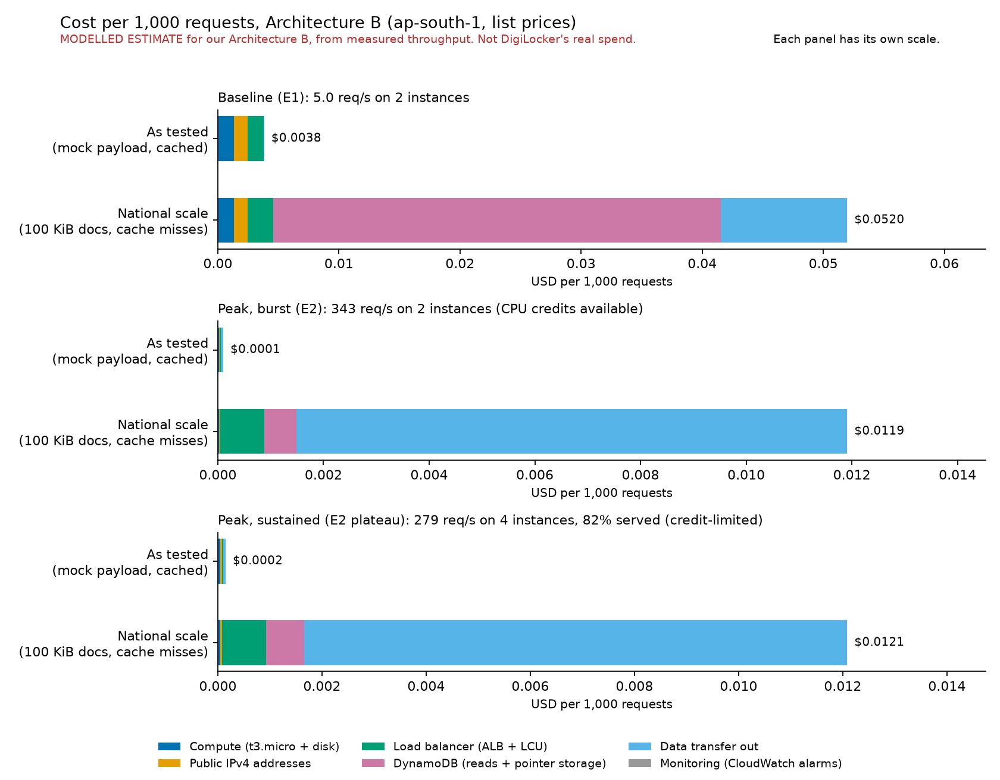
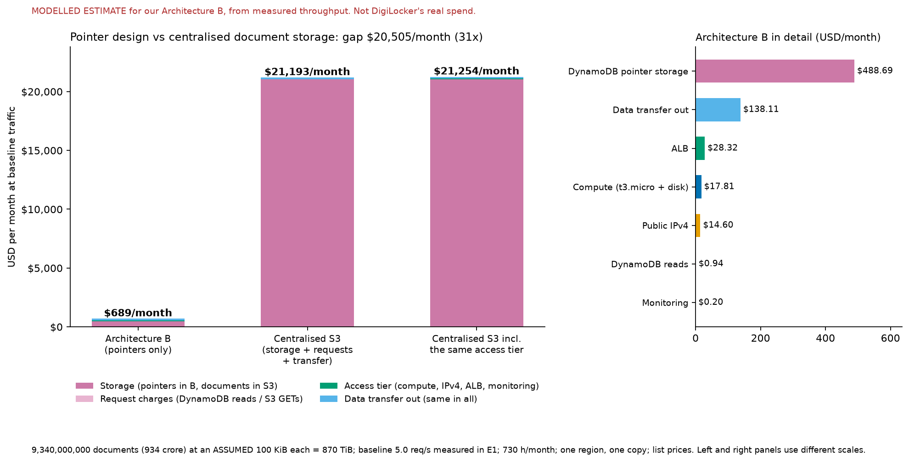

# Week 3 results: what was run, what it showed, and what it cost

IT457 Cloud Computing, Group 36. This is the Week 3 add-on to the Week 2 report
([digilocker_report.pdf](digilocker_report.pdf)). It states each experiment's result against the
expectation written down in Week 2, section 6, including where the result did not match and why.
Every figure below comes from the raw files under `results/aws/` or from `cost/results.json`, and
the section that uses it names the folder.

All cost figures are a **modelled estimate against our Architecture B, not DigiLocker's real
spend**, which is not published.

## 1. What was run

**Where and when.** AWS ap-south-1 (Mumbai), 29 October 2026 (UTC). **Multi-zone within one
region: ap-south-1a and ap-south-1b. The multi-region design in Week 2, section 4 was not built or
tested.**

**The system under test** (the EC2 build; `app/`, `mock-issuer/`, `infra/`):

- An Application Load Balancer in front of an Auto Scaling group of 2 to 4 `t3.micro` registry
  servers across the two zones (scaling target: 1,000 requests per target per minute).
- A DynamoDB table of document pointers. The registry stores pointers, never documents.
- Two mock issuers (CBSE and PARIVAHAN), each on its own `t3.micro`, with controls to make them
  slow or dead.
- Per issuer: a 1 s timeout, one retry with a random delay inside a retry budget, and a circuit
  breaker that opens when at least half of the last 10 calls fail (and at least 3 calls were made).
- Load from k6 on a laptop **outside AWS**, as planned, so about one round trip to Mumbai is in
  every latency figure.

**The runs.** Each scenario ran once. Folder names are under `results/aws/`.

| Run | Folder | Requests | Duration | k6 exit | Run check |
|---|---|---|---|---|---|
| E1 baseline | `20261029T194652Z-e1` | 901 | 180 s | 0 | Predates the check; verified afterwards (180 s span, longest gap 1 s) |
| E2 ramp | `20261029T210944Z-e2` | 210,829 | 901 s | 0 | valid (longest gap 7 s) |
| E3 instance loss | `20261029T213325Z-e3` | 5,959 | 300 s | 0 | valid (longest gap 0 s) |
| E4, breaker off | `20261029T214542Z-e4-breaker-off` | 6,895 | 270 s | 0 | valid (longest gap 1 s) |
| E4, breaker on | `20261029T215408Z-e4-breaker-on` | 6,894 | 271 s | 0 | valid (longest gap 1 s) |

Each folder holds the raw k6 data points (`*-raw.json.gz`), the summary, `run-info.txt`, k6's
console output, and a `cloudwatch/` folder of raw exports taken after the run. E2 also has
per-instance CPU and CPU-credit data in `cloudwatch/instances/`, and E3 has `terminate.log`.

**Provenance and discarded attempts.**

- Every `run-info.txt` records commit `70e77e7` with "(uncommitted changes)": the run tooling
  (stall check, warm-up, helper scripts) was still being committed while the runs were made. The
  code that ran is the working tree at that time, which has since been committed.
- Two attempts were invalid and deleted, not used: the first E2 (the laptop went to sleep for an
  hour, a 3,600 s gap in the data) and the first E4 with the breaker off (the operator's IP had
  changed, so issuer control was unreachable and the run aborted before any load). The run script
  now detects a stalled or off-duration run and exits with code 97.
- Before E4, `run.sh` sends 120 warm-up requests, identically for both runs (recorded in
  `run-info.txt`), so a freshly restarted registry's start-up stall (see E3) is not mistaken for
  the effect under test.
- For context, DigiLocker's average load is about 7.7 requests per second. That is derived: about
  72.86 crore document access transactions over three years (PIB release of 12 Aug 2026,
  <https://www.pib.gov.in/PressReleasePage.aspx?PRID=2298116>). E1's 5.0 requests per second is the
  same order of magnitude.

## 2. Results against the Week 2 expectations

| | Week 2 expectation (section 6) | Verdict |
|---|---|---|
| **E1** | "Flat latency, no scaling events, our control case" | **Held** |
| **E2** | "Latency flat, then a knee; new instances healthy in 2 to 4 minutes, slower than the arrival rate" | **Held in shape. The collapse beyond the knee was a CPU-credit effect on the scale-out instances, not the design's capacity** |
| **E3** | "Brief error spike, load balancer drains the unhealthy target, ASG replaces it" | **Partly held.** Drain and replacement happened. There was **no** error spike at the kill; the errors came later from the replacement's cold start |
| **E4** | "Without a breaker: both degrade. With one: affected issuer fails fast, healthy issuer unaffected" | **Held strongly** |

### E1: baseline (steady 5 requests per second for 3 minutes)

Source: `20261029T194652Z-e1`.

| Measure | Result | Week 2 target |
|---|---|---|
| Requests, served | 901, all served (100%) | |
| HTTP failures | 0.00% | under 1% at target load |
| Latency p50 / p95 / p99 | 149 / 243 / 786 ms (maximum 1,306 ms) | p95 under 1 second at baseline |
| p95 by minute | 415, 228, 220 ms | flat |
| Scaling activity during the run | none (desired capacity stayed at 2) | no scaling events |

**Verdict: held.** Latency was flat after the first minute. The first minute's higher p95 (415 ms)
is consistent with connection set-up at the start; the cause was not isolated. The 786 ms p99 and
1,306 ms maximum are single slow requests, not a trend.

### E2: ramp to peak concurrency (10 to 200 simulated users over 15 minutes)

Source: `20261029T210944Z-e2`, including `cloudwatch/instances/`.

**Latency against concurrency** (k6 `latency_at_N_vus` metrics):

| Concurrent users | p50 | p95 | Maximum |
|---|---|---|---|
| 10 | 66 ms | 101 ms | 1,507 ms |
| 25 | 69 ms | 107 ms | 1,459 ms |
| 50 | 78 ms | 118 ms | 1,497 ms |
| 100 | 180 ms | 279 ms | 1,597 ms |
| 150 | 210 ms | 1,185 ms | 10,025 ms |
| 200 | 139 ms | 1,248 ms | 10,033 ms |

**By minute** (UTC; throughput from the load balancer's own count; healthy hosts from CloudWatch,
which samples once a minute):

| Minute | Users | ALB req/s | Served | p50 / p95 (ms) | Healthy hosts |
|---|---|---|---|---|---|
| 21:09 | 10 | 4.8 | 100.0% | 67 / 104 | 2 |
| 21:10 | 10 | 56.9 | 100.0% | 66 / 99 | 2 |
| 21:11 | 25 | 64.7 | 100.0% | 69 / 106 | 2 |
| 21:12 | 25 | 141.4 | 100.0% | 69 / 107 | 2 |
| 21:13 | 50 | 152.9 | 100.0% | 78 / 117 | 2 |
| 21:14 | 50 | 268.2 | 100.0% | 78 / 118 | 2 |
| 21:15 | 100 | 278.2 | 100.0% | 170 / 261 | 2 |
| 21:16 | 100 | 343.8 | 100.0% | 188 / 289 | 2 (4 launched) |
| 21:17 | 150 | 342.9 | 99.9% | 261 / 551 | 2 |
| 21:18 | 150 | 294.3 | 82.7% | 100 / 1,268 | 3 |
| 21:19 | 200 | 235.8 | 81.1% | 95 / 1,322 | 4 |
| 21:20 | 200 | 277.3 | 81.4% | 1,028 / 1,245 | 4 |
| 21:21 | 200 | 276.9 | 82.3% | 412 / 1,236 | 4 |
| 21:22 | 200 | 279.6 | 80.4% | 355 / 1,240 | 4 |
| 21:23 | 200 | 279.2 | 82.0% | 895 / 1,243 | 4 |
| 21:24 | 200 | 216.8 | 77.7% | 1,103 / 1,250 | 4 (run ended 21:24:47) |

Overall: 91.6% served, 0.15% HTTP failures, p50 112 ms, p95 1,198 ms. From 21:18, latency is
bimodal (requests either came back quickly or waited out the 1 s issuer timeout), which is why the
p50 swings while the p95 sits near 1.2 s.

**Autoscaling timeline.**

- The run started at 21:09:44. Requests per target per minute exceeded the 1,000 target from the
  first full minute (1,707 at 21:10; `tg-requests-per-target.json`).
- The ASG launched two instances at **21:15:43**, **5 minutes 59 seconds after the start** (ASG
  history, `asg-scaling-activities.json`). The reaction was slow relative to how fast load rose.
- Healthy hosts rose to 3 in the 21:18 sample and 4 in the 21:19 sample: roughly **2 to 4 minutes
  after the launch**, within the expected window, at CloudWatch's one-minute resolution.

**Verdict: held in shape.** Latency was flat to 50 users (p50 66 to 78 ms), bent at 100 users
(p50 180 ms), and new instances became healthy in about 2 to 4 minutes, slower than the load
arrived. But the collapse at 150 to 200 users (served share falling from about 100% to about 81%,
requests per target per minute falling from 10,315 to about 4,150 to 4,200) needs a correction:

**Correction: the collapse beyond 100 users was a CPU-credit effect, not the design's capacity.**
`t3.micro` servers may use their full processor only while they hold CPU credits, and are held to
a 10% baseline when the credits run out. The per-instance data
(`cloudwatch/instances/`, 5-minute periods starting 21:20 UTC) shows:

| Instance | CPU credit balance (minimum) | CPU average / maximum |
|---|---|---|
| Registry, original, zone a | 14.81 | 13.5% / 14.0% |
| Registry, original, zone b | 16.97 | 13.6% / 13.9% |
| Registry, scaled out at 21:15:43, zone a | **0.00** | **10.0% / 10.0%** |
| Registry, scaled out at 21:15:43, zone b | **0.00** | **10.0% / 10.0%** |
| Mock issuer CBSE | 20.00 | 7.2% / 7.6% |
| Mock issuer PARIVAHAN | 20.05 | 7.2% / 7.4% |

Both scale-out instances had no credits and were pinned at the baseline cap. The original
instances never fell below about 14.7 credits and were not capped, and the issuers were not the
bottleneck. The timing matches the collapse. **How the capped instances dragged the whole service
down is an inference, not a measurement:** the load balancer keeps sending them a share of the
traffic while the simulated users wait on them, which lowers total throughput. Per-instance
latency was not collected to confirm it, and CPU credit balance is not reported for the first
period after launch, so the exact moment the cap began is not evidenced. The result shows how a
cheap burstable server behaves under a sudden, sustained spike. It does not show the maximum
capacity of the design.

### E3: losing a registry instance (steady 20 requests per second for 5 minutes)

Source: `20261029T213325Z-e3`, including `terminate.log`. One instance was terminated through the
Auto Scaling group 94 seconds into the run.

| Phase | Requests served | Failures | p50 / p95 / max |
|---|---|---|---|
| Before (first 90 s) | 1,800 of 1,800 (100.00%) | none | 65 / 85 / 178 ms |
| Gap (90 to 210 s; the kill was at 94 s) | 2,329 of 2,359 (98.73%) | 16 timeouts, 14 degraded replies | 64 / 122 / 10,010 ms |
| After (210 s to the end) | 1,800 of 1,800 (100.00%) | none | 64 / 80 / 375 ms |

The phase boundaries are the ones the k6 script tagged requests with (90 s and 210 s); the
instance was actually terminated at 94 s.

**Timeline** (UTC, k6 data and ASG history; run started 21:33:25):

| Time | Event |
|---|---|
| 21:34:59 (t+94 s) | Instance terminated (`terminate.log`) |
| 21:35:00 | ASG termination activity begins; healthy hosts drop to 1 in the 21:35 sample |
| 21:35:04 | ASG launches the replacement, 5 seconds after the kill |
| 21:35:04 to 21:36:52 | **No failed or degraded request** (the first appears at t+207.7 s) |
| 21:36:52 to 21:36:55 | Burst: 16 requests time out (10 s) and 30 requests in total are not served (t+207.7 to t+210.6 s) |
| 21:36 sample | 2 healthy hosts again |

**Verdict: partly held.** The load balancer drained the instance and the ASG replaced it, as
expected, and the surviving instance carried 20 requests per second at a p95 under 125 ms for the
whole period. Full capacity was back about 114 seconds after the kill (the moment the replacement
began taking traffic, inferred from the error burst and consistent with the instance journal
below). But the "brief error spike"
at the kill **did not happen**, and the errors that did occur came from a different cause.

**Correction 1: the kill was graceful.** Terminating through the ASG deregisters the instance from
the load balancer first, so no request was sent to a dead target. This tested one orderly removal
only. A sudden crash (an instance dying with no deregistration) was not tested and would be
expected to fail requests until the health checks notice.

**Correction 2: the errors came from the replacement's cold start, not from the kill.** The burst
came 114 seconds after the kill, when the replacement began taking traffic. The instance's journal
(read over SSM during the run, **not saved in `results/`**) shows its service started at 21:36:29
and its first document requests completed together at 21:36:53, about 10 seconds after they were
sent, which matches the 16 timeouts in the k6 data. The likely cause is the registry creating its
DynamoDB client on the first request. **Only the timing is verified, not the cause.**

### E4: a slow issuer, then a dead one; run twice (the central experiment)

Sources: `20261029T214542Z-e4-breaker-off` and `20261029T215408Z-e4-breaker-on`. Timeline: CBSE
healthy for 30 s; **3,000 ms latency** (the registry gives up at 1 s) until 120 s; **down** until
180 s; restored. CBSE received 20 requests per second throughout, which is enough to exhaust the
registry's connection pool when CBSE is slow; PARIVAHAN stayed healthy and received 5 requests per
second as a probe.
The only difference between the runs was the breaker switch. "Served" means the real document came
back.

**Headline: while CBSE was slow, the healthy issuer PARIVAHAN was served 24.9% of the time without
a breaker and 99.3% of the time with one.**

| Issuer | Phase | Breaker off: served, p50 / p95 | Breaker on: served, p50 / p95 |
|---|---|---|---|
| CBSE | baseline | 100.0%, 65 / 74 ms | 100.0%, 63 / 79 ms |
| CBSE | slow (3 s) | 0.3%, 1,053 / 4,033 ms | 0.7%, **51** / 263 ms |
| CBSE | down | 0.0%, 46 / 91 ms | 0.0%, 48 / 422 ms |
| CBSE | recovery | 99.7%, 63 / 92 ms | 97.6%, 73 / 302 ms |
| PARIVAHAN | baseline | 100.0%, 65 / 75 ms | 100.0%, 64 / 80 ms |
| **PARIVAHAN** | **slow** | **24.9%**, 1,043 / 1,114 ms | **99.3%**, **73** / 263 ms |
| PARIVAHAN | down | 100.0%, 64 / 84 ms | 100.0%, 72 / 382 ms |
| PARIVAHAN | recovery | 100.0%, 64 / 88 ms | 100.0%, 74 / 272 ms |

**Breaker behaviour** (breaker-on run, sampled every 2 seconds through the load balancer, so each
sample is one server's view): CBSE's breaker opened at t=33 s, 2 seconds after the fault at t=31 s;
it then went half-open about every 22 seconds and reopened while CBSE was still bad (45 s, 67 s,
89 s, 111 s); it closed at t=183 s, 2 seconds after the fault was lifted at t=181 s. **PARIVAHAN's
breaker was never anything but closed.**

**Verdict: held strongly.**

- Without a breaker both issuers degraded, even though only one was faulty: one slow dependency
  used up the registry's shared connection pool and the healthy issuer's requests waited out the
  1 s timeout.
- With a breaker, the affected issuer failed fast (median 51 ms against 1,053 ms) and the healthy
  issuer was almost unaffected (73 ms median, 99.3% served).
- While CBSE was fully down, the healthy issuer was fine in **both** runs. A failure that returns
  instantly does not tie up the pool; slowness does. This matches the Week 2 failure analysis (F2
  against F3).
- The Week 2 "what would make this fail" condition (no meaningful difference with the breaker on)
  did not occur.

**Costs of the breaker, stated plainly.** The 3 of 450 PARIVAHAN requests that were not served in
the on run came from the first moments before the breaker opened, and recovery after the fix is
slightly delayed by the breaker's 10 s recovery window (CBSE recovery phase 97.6% served with the
breaker, 99.7% without).

**What it means for DigiLocker.** DigiLocker is federated: in the full system a slow issuer must
not take down access to documents from the other **2,821** of the **2,822 onboarded issuers**
(PIB release of 5 Aug 2026,
<https://www.pib.gov.in/PressReleasePage.aspx?PRID=2294910>; the release gives no as-of date for
the count). E4 shows the mechanism with two issuers. It does not show it at that scale.

### The Week 2 section 5 metrics

| Metric | Measured? | Where |
|---|---|---|
| p50 and p95 latency | Yes | E1 |
| Latency against concurrency | Yes (knee at 100 users) | E2 |
| Error rate | Yes (0.00% at baseline) | E1 |
| Autoscaling reaction time | Yes (5 min 59 s to launch, about 2 to 4 min more to healthy) | E2 |
| Recovery time after zone loss | **No.** E3 removed one instance, not a zone; capacity returned in about 114 s | E3 |
| Behaviour with a degraded issuer | Yes | E4 |
| Cost per 1,000 requests | Modelled from measured throughput | section 3 |

## 3. Cost (a modelled estimate for our Architecture B)

Full method, rate table and assumptions are in [cost-model.md](cost-model.md); the numbers come
from `cost/results.json`. Summary:

- **Inputs.** Throughput measured in E1 and E2 (ALB counts agree with k6 within 0.7%); AWS
  ap-south-1 list prices from the AWS Price List API, retrieved 2026-10-31, each with its SKU
  (`cost/rates.py`). No free tier or credits applied.
- **Two profiles per scenario.** *As tested*: the 0.4 KB mock payload and 4 cached pointers.
  *National scale*: an assumed 100 KiB document, every lookup a DynamoDB read, and **9.34 billion
  pointers stored (more than 934 crore documents as of 31 July 2026, PIB factsheet
  <https://pib.gov.in/FactsheetDetails.aspx?Id=150840>)**.

| Scenario | Instances serving | As tested, per 1,000 requests | National scale, per 1,000 requests |
|---|---|---|---|
| Baseline (E1): 5.0 req/s | 2 | $0.003828 | $0.051978 |
| Peak, burst (E2): 343 req/s | 2 | $0.000103 | $0.011913 |
| Peak, sustained (E2 plateau): 279 req/s, 81.6% served | 4 | $0.000150 ($0.000184 per 1,000 served) | $0.012086 ($0.014814 per 1,000 served) |

- **At baseline the fixed costs dominate.** The same two instances, load balancer and public
  addresses are about 37 times cheaper per request when busy, so the idle platform's cost is mostly
  the cost of being available.
- **At national scale** the pointer table dominates at baseline traffic and data transfer out (87.5%)
  dominates at peak.
- **Not sustainable on this instance type.** The burst peak was reached on CPU credits (see E2). The
  sustained row is what the four-instance fleet delivered once credits ran out.

**The counterfactual: centralised storage on S3 instead of pointers.**

At baseline traffic (13,249,500 requests a month), for more than 934 crore documents of an
**assumed 100 KiB** each (870 TiB in S3 Standard, against 1,740 GiB of pointers in DynamoDB):

| USD per month | Architecture B | Centralised S3 (storage, requests, transfer) |
|---|---|---|
| Total | **688.68** | **21,193.44** |
| Gap | | **20,504.76 (30.8 times)** |
| Like-for-like gap (adding the same access tier to the S3 side) | | 20,565.69 (30.9 times) |

The saving is entirely storage; data transfer costs the same in both designs. One-off loading would
add $46,700 for S3 PUT requests against $6,631 for pointer writes.

**The document-size assumption and its break-even point.** The average issued-document size
(100 KiB) is an **assumption, neither measured nor sourced**; the reasoning is in
[cost-model.md](cost-model.md), "Why 100 KiB". Across 25 to 500 KiB central storage costs **9.4 to
80.7 times** our design (roughly 9 to 81 times). The centralised option would only cost the same as
our design at an average document size of about **2.4 KiB** (2.2 KiB like-for-like), a few lines of
text. So the direction of the result does not depend on the assumption; the dollar figure does,
and must be quoted with it. A record stored as signed XML alone, without the printable form, could
approach that break-even; the estimate assumes the printable form is stored. The ratio also barely
moves with the document count (30.5 to 31.2 times across 900 to 990 crore documents).

## 4. Limitations

- **One region, two zones.** Multi-region failover was not built or tested, and E3 did not remove
  a zone.
- **Each experiment ran once.** There are no repeats, so small differences should not be
  over-read. The E4 difference (24.9% against 99.3%) is large.
- **Load came from a laptop outside AWS.** About one round trip to Mumbai is in every latency, and
  k6 reuses connections, so the load balancer's new-connection dimension is understated against
  real browsers.
- **Burstable servers.** E2's behaviour beyond 100 users reflects `t3.micro` CPU credits. The
  reasoning about the load balancer's role is an inference.
- **E3 tested an orderly removal.** A hard crash and a zone loss were not tested. The cold-start
  cause is a hypothesis, and the instance-side timestamps are not in `results/`.
- **Mock issuers and payload.** The issuers are fake, the payload is 0.4 KB, authentication is a
  fixed API key, and each registry server keeps its own breaker state (not shared across the fleet).
- **Cost.**
  - It is a model at list price. The AWS usage was covered by account credits.
  - The document size and the pointer record size (200 B billed) are assumptions.
  - DynamoDB reads were not measured.
  - Per-server throughput with real 100 KiB documents was not measured, so the national-scale
    compute line is a lower bound.
  - The rates came from the AWS Price List API, not the Pricing Calculator web page.
- **Earlier local runs** (`results/session1/`) predate a connection-pool fix, are single-machine,
  and are kept as early tests, not as results.
- **The serverless live demonstration** (`lambda/`, `web/`; [live-demo.md](live-demo.md)) is a
  separate simplified variant and was not measured.

## 5. Open items and flagged figures

| Item | State |
|---|---|
| Cost rates against the AWS Pricing Calculator (estimate URL and screenshot) | **Open.** Placeholders in `cost-model.md`; the rates carrying the results are S3 storage, DynamoDB storage and reads, data transfer out, the load balancer, and public IPv4 |
| Average document size (100 KiB) | **Assumption**, justified in `cost-model.md`, not measured |
| 934+ crore documents (31 July 2026) | Verified in the PIB factsheet linked above. It replaces the Week 2 report's 941 crore, which matches no official figure |
| 2,822 onboarded issuers | PIB release of 5 Aug 2026; **no as-of date is given** (the same figure was in the 29 Jul release). It replaces the Week 2 report's 2,347, and "the other 2,346" in Week 2 section 4 becomes "the other 2,821" |
| CBSE ran several result platforms "deliberately to spread demand" | **Unattributed.** The multi-platform result day of 13 May 2026 is sourced; the stated motive is not ([research-log.md](research-log.md)) |
| Week 2 PDF text | Still says 941 crore, 2,347 and 2,346; the final report carries the corrected figures |
| E3 instance journal timestamps | Read over SSM during the run, not saved to `results/` |
| Optional follow-ups, not done | Re-run E2 on a non-burstable instance type or with unlimited credits; test a hard crash and a zone loss; warm the registry's database client at start-up; measure the serverless variant |

## 6. Where each claim is

| Claim | Evidence |
|---|---|
| E1, E2, E3, E4 results | `results/aws/<run>/*-summary.json` and `*-raw.json.gz` |
| Run validity, durations, warm-up | `results/aws/<run>/run-info.txt` |
| Load balancer throughput and healthy hosts | `results/aws/<run>/cloudwatch/*.json` |
| Autoscaling and replacement times | `results/aws/<run>/cloudwatch/asg-scaling-activities.json`, `results/aws/20261029T213325Z-e3/terminate.log` |
| CPU credits and per-instance CPU | `results/aws/20261029T210944Z-e2/cloudwatch/instances/` |
| Breaker states and fault timings | `results/aws/*e4*/k6-stderr.log` |
| Cost figures | `cost/results.json`, regenerated by `python cost/model.py` |
| Rates | `cost/rates.py` and `cost/rates_raw/` |
| Findings and fixes along the way | [research-log.md](research-log.md) |
